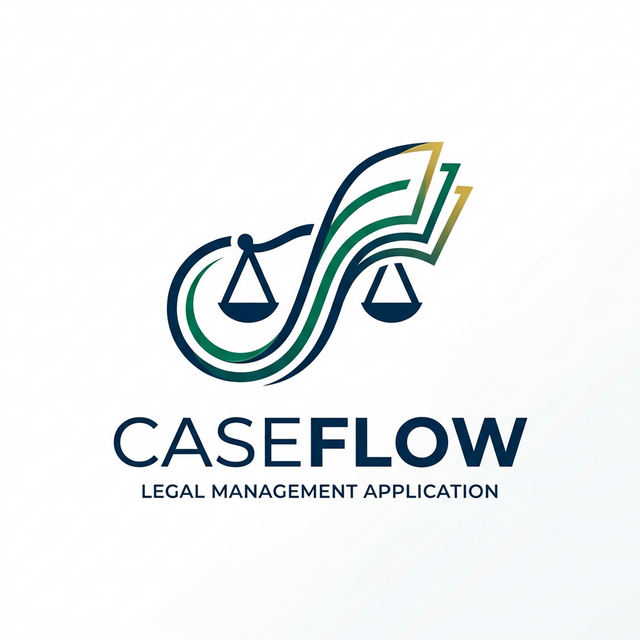
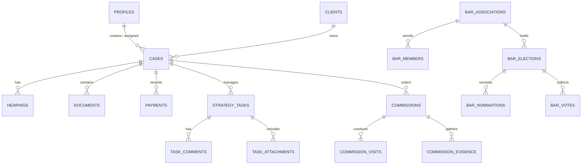

<p align="center">
  
</p>

<h1 align="center">CaseFlow — Backend Schema Specification</h1>

<p align="center">
  <strong>Version 2.5 · Database Architecture, DDL & Security Policies</strong><br/>
  <em>Confidential — For Database Administrators & Backend Engineers</em>
</p>

---

## 1. Relational Database Overview

CaseFlow's persistence engine is built on **PostgreSQL 15** via Supabase. The database consists of **38 tables** organized into 6 core logical domain schemas:
1. **Core Practice Management** (`profiles`, `clients`, `cases`, `hearings`, `documents`, `payments`, `user_roles`)
2. **Case Strategy Board** (`strategy_tasks`, `task_comments`, `task_attachments`, `task_activity_log`)
3. **Local Commission Module** (`commissions`, `commission_visits`, `commission_observations`, `commission_evidence`, `commission_expenses`, `commission_reports`, `commission_witnesses`, `commission_sketches`, `commission_notifications`)
4. **Bar Association Platform** (`bar_associations`, `bar_members`, `bar_admins`, `bar_notices`, `bar_notice_reads`, `bar_fee_payments`, `bar_elections`, `bar_election_posts`, `bar_nominations`, `bar_votes`, `bar_voter_participation`, `bar_events`)
5. **Legal & Citizen Services** (`bare_act_sections`, `caveats`, `certified_copies`, `ai_chat_sessions`)
6. **Telemetry & System** (`audit_logs`, `carousel_slides`, `fcm_tokens`, `device_tokens`)

---

## 2. Entity Relationship Diagram (ERD)



---

## 3. Data Dictionary & Table Definitions

### 3.1 Core Practice Schema

#### `profiles` (User & Advocate Directory)
Stores advocate profiles, firm links, and subscription parameters.
```sql
CREATE TABLE public.profiles (
    id                          UUID PRIMARY KEY REFERENCES auth.users(id) ON DELETE CASCADE,
    full_name                   TEXT NOT NULL DEFAULT '',
    email                       TEXT,
    user_role                   TEXT NOT NULL DEFAULT 'advocate',
    subscription_tier           TEXT DEFAULT 'free',
    firm_id                     UUID,
    bar_association_id          UUID REFERENCES public.bar_associations(id) ON DELETE SET NULL,
    registration_number         TEXT,
    practice_state              TEXT,
    practice_district           TEXT,
    office_address              TEXT,
    mobile_number               TEXT,
    is_admin                    BOOLEAN DEFAULT false,
    is_public_directory_enabled BOOLEAN DEFAULT true,
    last_seen_at                TIMESTAMPTZ,
    created_at                  TIMESTAMPTZ NOT NULL DEFAULT now(),
    updated_at                  TIMESTAMPTZ NOT NULL DEFAULT now()
);
```

#### `cases` (Primary Case Ledger)
```sql
CREATE TABLE public.cases (
    id                UUID PRIMARY KEY DEFAULT gen_random_uuid(),
    client_id         UUID NOT NULL REFERENCES public.clients(id) ON DELETE CASCADE,
    case_title        TEXT NOT NULL,
    case_number       TEXT,
    cnr_number        TEXT UNIQUE,
    case_type         TEXT,
    court_name        TEXT,
    stage             TEXT NOT NULL DEFAULT 'filing',
    status            TEXT NOT NULL DEFAULT 'active',
    filing_date       DATE,
    next_hearing_date DATE,
    assigned_to       UUID REFERENCES auth.users(id),
    firm_id           UUID,
    created_by        UUID NOT NULL REFERENCES auth.users(id) ON DELETE CASCADE,
    deleted_at        TIMESTAMPTZ,
    created_at        TIMESTAMPTZ NOT NULL DEFAULT now()
);
```

#### `hearings` (Court Diary & Adjournments)
```sql
CREATE TABLE public.hearings (
    id             UUID PRIMARY KEY DEFAULT gen_random_uuid(),
    case_id        UUID NOT NULL REFERENCES public.cases(id) ON DELETE CASCADE,
    hearing_date   DATE NOT NULL,
    stage          TEXT,
    notes          TEXT,
    next_action    TEXT,
    adjourn_reason TEXT,
    is_completed   BOOLEAN DEFAULT false,
    created_by     UUID NOT NULL REFERENCES auth.users(id) ON DELETE CASCADE,
    created_at     TIMESTAMPTZ NOT NULL DEFAULT now()
);
```

### 3.2 Case Strategy Board Schema

#### `strategy_tasks` (Kanban Task Cards)
```sql
CREATE TABLE strategy_tasks (
    id                UUID PRIMARY KEY DEFAULT gen_random_uuid(),
    case_id           UUID NOT NULL REFERENCES cases(id) ON DELETE CASCADE,
    title             TEXT NOT NULL,
    description       TEXT,
    stage             TEXT NOT NULL DEFAULT 'todo'
                      CHECK (stage IN ('todo', 'in_progress', 'review', 'filed', 'done')),
    position          INTEGER NOT NULL DEFAULT 0,
    assigned_to       UUID REFERENCES profiles(id) ON DELETE SET NULL,
    created_by        UUID NOT NULL REFERENCES profiles(id),
    priority          TEXT NOT NULL DEFAULT 'medium'
                      CHECK (priority IN ('low', 'medium', 'high', 'urgent')),
    due_date          DATE,
    linked_hearing_id UUID REFERENCES hearings(id) ON DELETE SET NULL,
    firm_id           UUID,
    is_auto_generated BOOLEAN DEFAULT false,
    completed_at      TIMESTAMPTZ,
    deleted_at        TIMESTAMPTZ,
    created_at        TIMESTAMPTZ DEFAULT now(),
    updated_at        TIMESTAMPTZ DEFAULT now()
);
```

---

## 4. Row Level Security (RLS) Policy Engine

CaseFlow mandates strict tenant isolation via Row Level Security.

### 4.1 Multi-Tenant Firm Isolation Strategy
```sql
-- RLS Policy: Selective Access to Strategy Tasks
CREATE POLICY "strategy_tasks_select" ON strategy_tasks
    FOR SELECT USING (
        created_by = auth.uid()
        OR assigned_to = auth.uid()
        OR firm_id = auth.uid()
        OR firm_id = (SELECT firm_id FROM profiles WHERE id = auth.uid())
    );

CREATE POLICY "strategy_tasks_insert" ON strategy_tasks
    FOR INSERT WITH CHECK (created_by = auth.uid());
```

---

## 5. Storage Bucket Definitions

| Bucket ID | Access Control | Allowed MIME Types | File Size Limit |
|:---|:---:|:---|:---:|
| `case-documents` | Private (RLS) | `application/pdf`, `image/*` | 50 MB |
| `chat-attachments` | Public Read | `application/pdf`, `image/*`, `audio/*` | 25 MB |
| `commission-evidence` | Public Read | `image/jpeg`, `image/png` | 15 MB |
| `commission-sketches` | Public Read | `image/png` | 10 MB |
| `profile-photos` | Public Read | `image/jpeg`, `image/png` | 5 MB |
| `bare_acts` | Public Read | `application/pdf` | 100 MB |

---

<p align="center">
  <em>End of Backend Schema Specification · CaseFlow Engineering Group</em>
</p>
